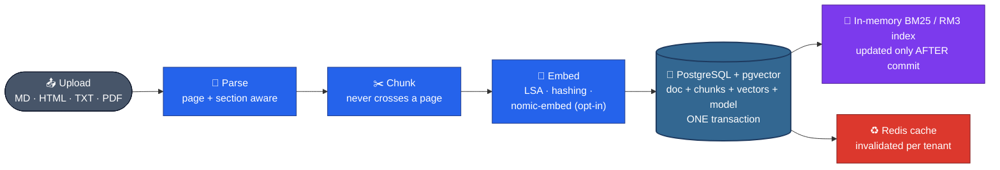
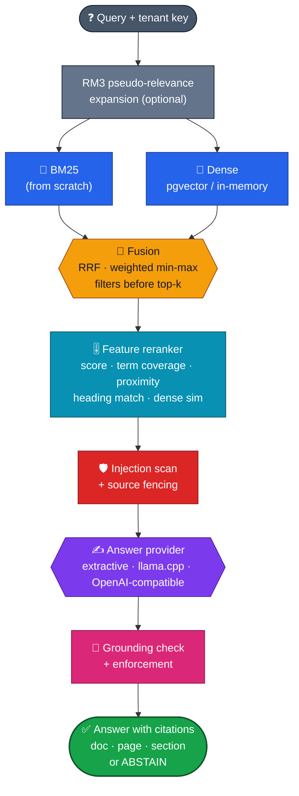
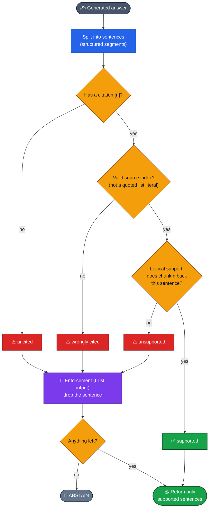
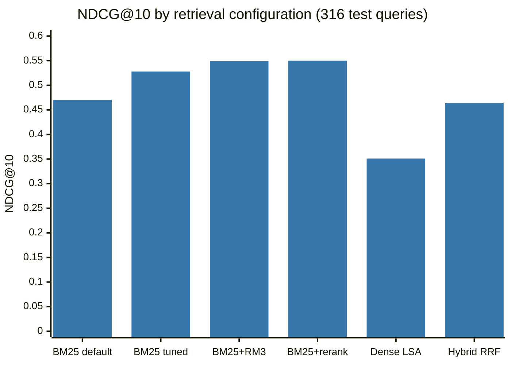
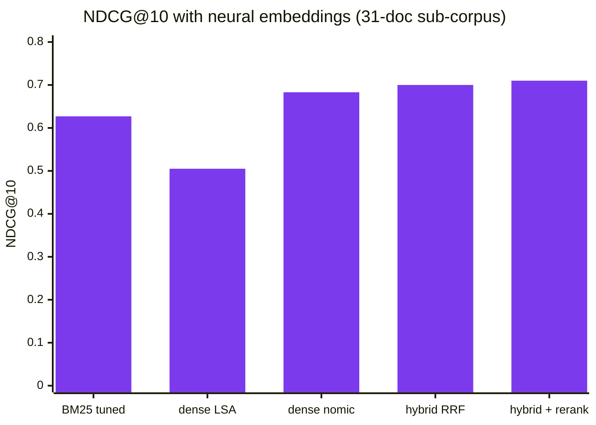

<div align="center">

# 📚 Groundwork

### A retrieval and grounded-answer (RAG) engine that measures itself: every answer sentence cites a source chunk by document, page and section, and every citation is checked

**BM25 from scratch · dense (pgvector) · hybrid fusion · RM3 · feature reranker · citation grounding · prompt-injection defence · reproducible evaluation with confidence intervals**

<br/>


-111827?style=for-the-badge)

-16a34a?style=flat-square)


[**Pipelines**](#%EF%B8%8F-pipelines) · [**Algorithms**](#-core-algorithms-implemented-not-wrapped) · [**Grounding**](#-citation-grounding) · [**Results**](#-retrieval-results) · [**Local models**](#-real-local-models-opt-in) · [**Security**](#%EF%B8%8F-prompt-injection-defence) · [**Quick start**](#-quick-start)

</div>

---

## 📌 TL;DR

Most RAG demos show an answer and hope it's right. Groundwork treats retrieval and grounding as things to **measure**:

| | |
|---|---|
| 📥 **Ingest** | Markdown, HTML, text and **PDF with page numbers**; page- and section-aware chunking that **never crosses a page**, so a citation always names exactly one page |
| 🔎 **Retrieve** | **BM25 written from scratch** · dense vectors in **pgvector** · RRF or weighted **hybrid fusion** · **RM3** query expansion · a feature **reranker** tuned on dev |
| 🧷 **Ground** | Every answer sentence carries citations (doc · page · section); each is **checked for support**, and unsupported sentences are removed or the system **abstains** |
| 🛡️ **Defend** | Injection scan after NFKC normalisation · **source fencing** immune to delimiter look-alikes · output sanitising against link/image exfiltration |
| 📏 **Evaluate** | NDCG / MRR / Recall with **bootstrap CIs and paired significance tests** · groundedness, citation precision, abstention · injection robustness · a **regression gate** in CI · **no LLM judge** |
| 🏢 **Serve** | Multi-tenant FastAPI with API keys · Redis query cache (per-tenant invalidation) and rate limits that **degrade safely** · usage accounting · Prometheus metrics |

---

## 🛤️ Pipelines

### Ingest: one transaction



### Query: retrieve, then prove it



---

## 🧠 Core algorithms (implemented, not wrapped)

| Area | Implementation |
|---|---|
| **Lexical retrieval** | Inverted index with **Okapi BM25** (Lucene IDF), with incremental add and delete. A **property test** checks that deleting a document gives *exactly* the scores of never adding it |
| **Dense retrieval** | LSA (TF-IDF + truncated SVD, fitted per tenant) or signed feature hashing offline; opt-in **nomic-embed-text-v1.5** via llama.cpp. **pgvector HNSW benchmarked against exact search** |
| **Fusion** | Reciprocal rank fusion and min-max weighted fusion; metadata filters applied *before* top-k |
| **Query rewriting** | **RM3** pseudo-relevance feedback interpolated with the original query |
| **Reranking** | Linear model over first-stage score, query-term coverage, **minimal covering window** (proximity), heading match and dense similarity, tuned on dev; opt-in **Qwen3-Reranker-0.6B** |
| **Evaluation** | Recall@K, MRR, NDCG with **bootstrap confidence intervals and paired tests**; retrieval and generation scored **separately**, deterministically |

---

## 🧷 Citation grounding



The extractive provider (over BM25 + reranker) answers in **5.8 ms at the median**, abstains on 6.0% of test queries, and cites the *labelled* relevant section in 42% of the answers it gives.

---

## 📊 Retrieval results

**pystdlib test split, 316 queries** (a known-item dataset built automatically from CPython standard-library docstrings and checked in, so results don't depend on your Python version).



| Configuration | NDCG@10 [95% CI] | MRR@10 | Recall@10 |
|---|:---:|:---:|:---:|
| BM25, default parameters | 0.470 [0.429, 0.512] | 0.404 | 0.677 |
| BM25, tuned on dev | 0.528 [0.483, 0.571] | 0.472 | 0.703 |
| BM25 + RM3 | 0.549 [0.507, 0.590] | 0.484 | **0.753** |
| **BM25 + reranker** | **0.550** [0.506, 0.592] | **0.494** | 0.725 |
| Dense LSA-384 | 0.351 [0.311, 0.390] | 0.283 | 0.570 |
| Hybrid (RRF) | 0.464 [0.422, 0.504] | 0.389 | 0.703 |

<sub><b>Reading it honestly:</b> tuned BM25 with RM3 or the reranker wins here, and their confidence intervals overlap. The <i>offline</i> dense retrievers are weak, and fusing with them doesn't help. That conclusion does <b>not</b> transfer to neural embedders (see below). pgvector HNSW reaches recall@10 ≥ 0.993 against exact search at <code>ef_search</code> ≥ 40.</sub>

---

## 🤖 Real local models (opt-in)

Neural models run on CPU through **llama.cpp**: nomic-embed-text-v1.5 embeddings, Qwen2.5-0.5B / SmolLM2 answer providers, and a Qwen3 reranker. Evaluated on a 31-document sub-corpus (80 test queries).



- **Neural embeddings help:** hybrid nomic + BM25 is **significantly better than BM25 alone (p = 0.005)**, reaching 0.710 NDCG@10 with the reranker.
- **Small LLMs ground poorly, and the metrics expose it:** only **15%** of Qwen2.5-0.5B's sentences were supported by their citations (SmolLM2-360M: 0%). With grounding enforcement every displayed sentence is supported, but Qwen then abstains on 65% of queries. **The deterministic extractive provider remains the better default.**

---

## 🛡️ Prompt-injection defence


| Attack | Result |
|---|---|
| Known-style injections (extractive) | **200/200 kept out of the context** |
| **Paraphrased injections** (extractive) | **0/200 detected**; they reached 6% of answers. The pattern scanner is defence in depth, **not** a security boundary |
| Qwen2.5-0.5B, fencing + system prompt only | 6/10 known-style attacks succeeded |
| Qwen2.5-0.5B, **all defences** | **0/10 in both template families** |

---

## 🔍 Audit: 13 defects, each fixed failing-first

An independent adversarial reviewer with read-only access had to **reproduce every claim**. Every fix has a regression test that **fails on the old code** (verified by stashing the fix).

| ID | Sev. | Defect |
|:---:|:---:|---|
| A1 | 🔴 high | After deletes dropped below the LSA threshold, a restart loaded the *hashing* embedder while stored vectors were LSA |
| A2 | 🔴 high | The LSA refit ran **outside** the ingest transaction: a failure left a committed document, a mismatched model and a stale cache |
| A6 | 🟠 med | The global engine lock was held during answer generation (possibly a 60 s HTTP call), **blocking every tenant and `/healthz`** |
| A3 | 🟠 med | The output sanitiser missed upper-case schemes, `//` URLs, HTML ``, reference-style links and userinfo host spoofing |
| A7 | 🟡 low-med | Zero-width / full-width delimiter look-alikes survived fencing and evaded the scanner |
| D1 | 🟠 med | Quoted Python list literals (`[0, 1, 2]`) were parsed as citations |
| S1 | 🟠 med | Stemmer disagreed on inflections ("resolved" vs "resolves"), so answers missed the right sentence |

<sub>…plus HTML/Markdown parser edge cases, unauthenticated metrics leaking tenant names, and cache hits missing from usage logs. Full list: <a href="docs/audit.md"><code>audit.md</code></a></sub>

---

## 🚀 Quick start

```bash
pip install -e '.[dev]'                       # Python ≥ 3.11
# PostgreSQL with pgvector on 127.0.0.1:5432 (user postgres), Redis on 6379 (or: docker compose up)
pytest                                        # 81 tests (+5 opt-in local-model tests)
./scripts/demo.sh                             # upload → grounded Q&A with page refs → abstention
python -m groundwork serve --port 8080
python benchmarks/retrieval_bench.py OUT --pg postgresql://postgres@127.0.0.1:5432/postgres
```

<details>
<summary><b>🤖 Local neural models (opt-in)</b></summary>

<br/>

```bash
pip install -e '.[local]'                     # llama-cpp-python (CPU)
python scripts/fetch_models.py                # GGUF files into GW_MODEL_DIR
GW_RUN_LOCAL_MODELS=1 pytest tests/test_local_models.py
GW_DIM=768 GW_EMBEDDER=nomic GW_LLM_PROVIDER=llamacpp python -m groundwork serve
```

</details>

---

## 🧭 Design decisions

| Decision | Trade-off |
|---|---|
| **PostgreSQL is the source of truth; the query index is in memory** ([ADR 0002](docs/decisions/0002-in-memory-query-index.md)) | BM25, RM3 and the reranker are explicit and fast; costs start-up time, memory and one process per index |
| **Offline embedders by default, neural opt-in** ([ADR 0001](docs/decisions/0001-dense-retrieval-without-pretrained-models.md)) | Runs anywhere and deterministically; weaker dense retrieval until neural is enabled |
| **Deterministic evaluation, no LLM judges** ([ADR 0003](docs/decisions/0003-deterministic-evaluation.md)) | Reproducible numbers; groundedness is a lexical proxy |
| **Chunks never cross a page** | Every citation names exactly one page; slightly more fragmentation |

---

## ⚠️ Limitations

- **Neural results come from a 31-document sub-corpus** and 20 generation queries on an overloaded CPU. The Qwen3 reranker's quality wasn't measured.
- **The grounding check is lexical**, not NLI-based, and **injection detection is pattern-based** (paraphrases get through).
- **One known-item dataset**, with no multi-hop questions. Single process. The OpenAI-compatible provider is only tested with a mock.
- **Not deployed, no real users.**

Full list: [`limitations.md`](docs/limitations.md) · [`architecture.md`](docs/architecture.md) · [`benchmarks.md`](docs/benchmarks.md) · [`security.md`](docs/security.md) · [`testing.md`](docs/testing.md)

---

## 📁 Repository layout

```text
GROUNDWORK/
├── groundwork/       📚 ingest · retrieve (BM25, dense, fusion, RM3, rerank) · generate · grounding · store · API · local_models
│   └── evaluation/   📏 retrieval + generation metrics, bootstrap CIs, paired tests
├── tests/            ✅ core · audit regressions · generation safety · regression gate · local models (opt-in)
├── benchmarks/       📊 retrieval + neural benchmarks, baseline.json, recorded results
├── data/pystdlib/    🗂️ checked-in dataset: docs, queries, relevance judgements
├── scripts/          🛠️ demo.sh · fetch_models.py
├── examples/         💡 sample documents
└── docs/             📖 architecture · benchmarks · audit · security · deployment · ADRs
```

---

<div align="center">

**An answer is only as good as the source it can point to.**

<br/>

Built by **[Siddhant Singh](https://github.com/siddhaantxsingh)** · <sub>MIT License</sub>

</div>
